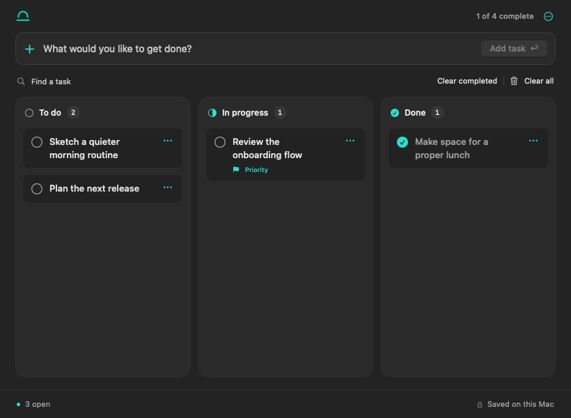

# Daymark

A quiet, local-first task board for your Mac’s menu bar. Capture a task, focus on the next thing, and move it from **To do → In progress → Done**.



## Download

[Download Daymark 0.1.0 for Apple silicon](https://github.com/Sarfraz-droid/daywork/raw/refs/heads/main/docs/downloads/Daymark-macOS-arm64.zip) · [Verify SHA-256](docs/downloads/SHA256SUMS.txt)

Requires **macOS 13 or later** and an **Apple silicon Mac (M1 or later)**. Intel users can build from source.

1. Unzip the download and move `Daymark.app` to Applications.
2. Open the app, then click the sunrise icon in the menu bar.
3. Add a task and press Return.

This early build is ad-hoc signed, not Developer ID signed or notarized. macOS may block the initial launch. Read [Apple’s guidance on opening apps safely](https://support.apple.com/102445) before choosing whether to allow it in System Settings → Privacy & Security.

## Features

- A three-column board with drag and drop.
- Your in-progress task appears in the menu bar.
- Editing, priorities, title search, and JSON export.
- Clear completed or clear all with confirmation. Undo the last change, including deletion or clearing.
- A brief confetti burst on Add; a quiet confirmation with Reduce Motion.
- Right-click the menu bar icon for Open board, Undo, Clear completed, and Quit.
- Automatic local saving. No accounts, cloud sync, or app analytics.

| Shortcut | Action (while the board is open) |
| --- | --- |
| Return | Add a task |
| ⌘N | Focus the new task field |
| ⌘F | Search tasks |
| ⌘Z | Undo the last task change |

Double-click a task title to edit it. Priority tasks appear first in their column. Undo history lasts for the current session. Existing Notch/Daymark task data is preserved through the original preferences identifier.

## Build from source

Requires Xcode command line tools and Swift 5.9 or later.

```sh
git clone git@github.com:Sarfraz-droid/daywork.git
cd daywork
./build-app.sh
open Daymark.app
```

The build script accepts SwiftPM arguments and locates the executable using `--show-bin-path`, so it supports different Swift build systems and native Intel builds.

```sh
swift test
./scripts/package-release.sh
python3 scripts/check-site.py
```

Packaging produces `release/Daymark-macOS-arm64.zip`, refreshes `docs/downloads/`, and records its SHA-256 checksum. It always builds the downloadable Apple silicon version. `Daymark.app` and build products are ignored by Git; the packaged website download is intentionally tracked.

## Landing page and Vercel

The responsive, dependency-free site lives in `docs/`. Its download uses a relative URL and works on Vercel, a local server, or a repository subpath.

```sh
python3 -m http.server 5173 --directory docs
```

Open http://localhost:5173. `python3 scripts/check-site.py` checks asset links, anchors, the ZIP contents, and its checksum.

Import **Sarfraz-droid/daywork** at [Vercel’s new project screen](https://vercel.com/new) and keep the project root at the repository root. The committed `vercel.json` supplies:

- Framework: Other (static HTML)
- Build command: `python3 scripts/check-site.py`
- Output directory: `docs`
- No dependency install step

After connecting the repository, Vercel deploys changes to `main` and provides previews for pull requests. The site requires no environment variables. With an authenticated Vercel CLI you can also run `vercel link --project daywork` and `vercel deploy` for a preview.

## Releases and checks

GitHub Actions tests the app, builds an Apple silicon archive, and validates the website on pushes and pull requests. A version tag publishes the Mac ZIP and checksum as a GitHub release:

```sh
git tag v0.1.0
git push origin v0.1.0
```

Before a later release, update the version in `build-app.sh` and the website copy, run `./scripts/package-release.sh`, and commit the refreshed download. Vercel will deploy the matching download with the landing page.

Developer ID signing and Apple notarization require your Apple Developer credentials and are not configured in this repository.
